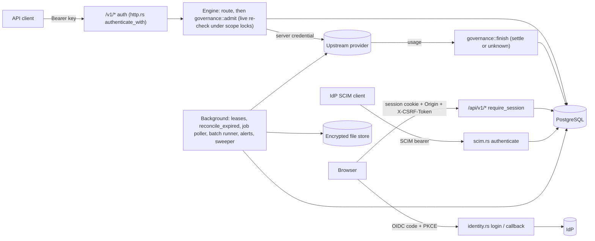

# Threat model

This is a STRIDE-style threat model of Open Model Gateway for code reviews and the independent security review (#61). It records what the code does today, with the tests that cover it, and where it falls short. It is not a certification or a penetration test.

Every mitigation names the file and function that implement it. Every test is named by file and function and was found with `grep` on `main` at commit `527892f` (the v0.5.0 release merge). "No test found" means a search found none, not that the behaviour is wrong. Paths are relative to `apps/gateway/src/` unless they start with `apps/`, `deploy/`, `tests/`, `scripts/` or `.github/`; those start at the repository root. The gateway's integration tests are under `apps/gateway/tests/`; `tests/` holds the browser, container, Helm, demo and backup tests.

The invariants in [AGENTS.md](../AGENTS.md) are the security properties this model protects. [Architecture](architecture.md) describes the boundaries.

## Scope and assumptions

**Deployment model.** One installation serves one enterprise. The gateway is one Rust binary (`open-model-gateway serve`) behind TLS ingress, with one or more replicas sharing one PostgreSQL primary, an optional read-only reporting replica, and an optional encrypted file store (local disk or S3-compatible). The same binary serves `/v1/*` (inference, inference-key auth), `/api/v1/*` (management, browser-session auth), `/scim/v2/*` (SCIM bearer token), `/health/*` and, if `GATEWAY_WEB_DIR` is set, the built SPA. Metrics are on an optional separate listener (`GATEWAY_METRICS_ADDR`).

**Trust boundaries.**

1. Internet to ingress to gateway: every request is untrusted until a credential is verified.
2. Gateway to PostgreSQL: the runtime role (`gateway_runtime`) has the column-level allowlist in `deploy/staging/runtime-grants.sql`. The schema owner (`gateway_migrator`) is used only by operator commands (`migrate`, `grants apply`, `archive`).
3. Gateway to the IdP: OIDC discovery, JWKS and the token endpoint over HTTPS.
4. Gateway to upstream providers: fixed HTTPS cloud origins, allowlisted Bedrock and S3 endpoints, and local endpoints approved out of band (`GATEWAY_LOCAL_UPSTREAMS`).
5. Gateway to the file store: ciphertext only.
6. Gateway to the SMTP relay: TLS except to a loopback relay.
7. Operator to host: environment variables, secret files, the CLI and backups.

**Assumptions.** TLS terminates at the ingress. The host, the container runtime, the master keys and the schema-owner credential are trusted. The IdP is trusted to sign correct `email_verified` and group claims. Provider prices are estimates set by Platform Admins.

**In scope:** the binary, the dashboard (`apps/web`), the image (`Dockerfile`), the Helm chart (`deploy/helm`), staging (`deploy/staging`) and the operator scripts (`scripts/backup.py`). This matches [SECURITY.md](../SECURITY.md).

**Out of scope:** model behaviour and prompt injection inside the caller's own workspace (guardrails are #36), volumetric denial of service, a compromised host or schema-owner role, and the demo (`bootstrap-demo`, `scripts/demo-oidc.mjs`), except that the demo's guards must stop it reaching a real deployment (OPS-7).

## Assets

| Asset | Where it lives |
| --- | --- |
| Inference keys | SHA-256 hash in `api_keys.secret_hash`; plaintext only in the one creation or rotation response |
| Browser sessions and CSRF tokens | SHA-256 hashes in `browser_sessions`; cookies `omg_session`, `omg_csrf` and `omg_oidc` |
| SCIM token | Environment variable named by `GATEWAY_SCIM_TOKEN_ENV`; only its hash is held in memory (`scim.rs` `ScimConfig`) |
| Provider credentials, SMTP password, S3 keys | Environment variables named by `env:` references, allowed by `GATEWAY_SECRET_ENV_ALLOWLIST`; Bedrock and S3 also use workload identity |
| File-store master keys | Environment variable named by `GATEWAY_FILE_ENCRYPTION_KEYS_ENV` |
| Stored files (batch inputs and outputs, Files API uploads, logo) | Encrypted objects; metadata in `stored_files` |
| Platform roles, memberships, group mappings | `platform_role_grants`, `workspace_membership_grants`, `oidc_group_mappings` |
| Budgets, limits, reservations, ledger | `policy_budgets`, `*_policies`, `governance_reservations`, `monetary_ledger`, `budget_totals`, counters |
| Prices and audit history | `deployment_prices`, `audit_events` (append-only) |
| Request metadata | `inference_executions` (no prompt or response columns) |
| Personal-workspace privacy | Keys and request details visible to the owner only |
| Release images | `ghcr.io/ncecere/open-model-gateway`, signed with cosign |

## Actors

| Actor | Can do |
| --- | --- |
| Unauthenticated internet client | Reach `/v1/*`, `/api/v1/auth/*`, `/scim/v2/*`, `/health/*`, the SPA and the public logo |
| Inference key holder | Call `/v1/*` for the key's workspace |
| Workspace member | Dashboard session; own keys and activity in a shared workspace |
| Workspace admin (owner or admin) | Members, service accounts, tighten-only limits and model selection in a shared workspace; workspace-wide activity |
| Platform Auditor | Read Admin pages and platform totals; no writes; no personal details |
| Platform Admin | Configure connections, models, prices, catalogs, mappings, settings, and platform limits; no personal details |
| Compromised replica or DB credential | Everything the runtime role can do, plus every secret in that replica's environment |
| Malicious upstream provider | Return any status, headers, body, stream or usage |
| Operator | Host, environment, CLI with schema-owner credentials, backups, deployment |

## Data flows

- **Inference request.** `http.rs` `credential` reads exactly one `Authorization: Bearer` (or `x-api-key` on `/v1/messages`). Engine routes authenticate through the per-replica key cache (`Store::authenticate_inference`); file, batch, video and realtime routes authenticate live (`Store::authenticate`). The engine picks a deployment. `governance::admit_unobserved` takes the catalog lock and the scope locks (shared), re-checks key, user, membership or service account, model eligibility and key restrictions live (`auth::revalidate_admission_with`), checks every limit, and writes the execution, the reservation and the ledger hold in one statement. The adapter builds a new upstream request with the server's credential. `governance::finish_unobserved` settles the reservation or marks it unknown.
- **Dashboard session.** `GET /api/v1/auth/login` stores the hashed state with the nonce and PKCE verifier, bound to the hash of an `omg_oidc` browser cookie. `callback` consumes the attempt, exchanges the code, verifies the ID token, synchronizes groups (`resolve_identity_with`) and issues a hashed 12-hour session. `require_session` checks the session and current platform role on every request and, for every method other than GET and HEAD, the exact Origin and the CSRF token.
- **SCIM.** The IdP pushes users and groups to `/scim/v2` with the bearer token. Deactivation revokes sessions and keys. Pushed groups feed group mappings with group provenance.
- **Background jobs.** Singleton jobs (cleanup, compaction, counter pruning, alert evaluation, the file sweeper, partition creation) run under fenced leases (`leases.rs`). Queues (lease reconciliation, async-job polling, batch lines, alert deliveries) use `FOR UPDATE SKIP LOCKED` on every replica.

## Threats

Each entry gives the STRIDE category (S, T, R, I, D, E), the asset and attacker, the mitigation, the tests, the residual risk and a follow-up. "Review: #61" means no new work is proposed, but the independent review should check it.

### Tenancy and workspace isolation

**TEN-1. An inference key acts outside its workspace.** I, E · Asset: other workspaces' models, files, jobs and usage · Attacker: inference key holder.
- Mitigation: the workspace comes only from the `Principal` built by `auth.rs` `authenticate_live`, never from headers or bodies. Admission selects the deployment with `workspace_model_allowed($1,m.id)` and the key-restriction subqueries (`governance::admit_unobserved`). Files, batches and videos are filtered by `principal.workspace_id` (`protocols/files.rs` `list`, `retrieve`, `content`, `delete`; `jobs/store.rs` `list`). History tables check scoped parents with insert triggers (migration 0034).
- Tests: `apps/gateway/tests/database.rs` `http_enforces_workspace_scope_and_unregistered_protocol_errors`; `apps/gateway/tests/inference.rs` `deployment_resolution_cannot_cross_workspaces`; `filestore/api_tests.rs` `files_are_scoped_to_the_key_workspace`; `jobs/db_tests.rs` `jobs_are_private_to_their_workspace`; `jobs/batch_tests.rs` `batches_are_private_to_their_workspace`; `history/tests.rs` `history_inserts_check_scoped_parents`.
- Residual: isolation is in application queries, not PostgreSQL row-level security. A new query without the workspace predicate leaks.
- Follow-up: Review: #61 (including the RLS assessment listed in the roadmap).

**TEN-2. Platform staff read a personal workspace's keys or request details.** I · Asset: personal privacy · Attacker: Platform Auditor, Platform Admin.
- Mitigation: `management/resources.rs` `access_inner` denies a personal workspace to anyone but its owner, whatever the platform role. Platform reports aggregate personal usage into totals. The key-safety platform view returns personal keys as counts only.
- Tests: `management/tests.rs` `personal_details_are_owner_only_even_platform_admin_and_auditor`; `apps/gateway/tests/enterprise_privacy.rs` `platform_admin_and_auditor_get_personal_totals_without_private_keys_or_details`; `management/logs_tests.rs` `platform_logs_show_shared_workspaces_only_never_personal`; `management/snapshot_tests.rs` `snapshot_reads_keep_personal_activity_owner_private`; `management/key_safety_tests.rs` `key_safety_members_see_own_keys_and_personal_keys_stay_private`.
- Residual: anyone with database access sees everything. Totals by workspace still show how much a person uses, by design.
- Follow-up: #31 and #74 (owner-private subject export).

**TEN-3. A personal workspace is shared.** E · Asset: personal privacy · Attacker: workspace member, Platform Admin.
- Mitigation: migration 0001 triggers `service_account_shared`, `invitation_shared` and `group_mapping_shared` (`require_shared_workspace()`); `auth.rs` `revalidate_admission_with` accepts a human key on a personal workspace only for its owner.
- Tests: `apps/gateway/tests/database.rs` `personal_workspace_cannot_be_shared_by_issuing_another_users_key`; `auth/enterprise_tests.rs` `workspace_foreign_keys_and_personal_privacy_are_enforced`.
- Residual: none found beyond TEN-1.
- Follow-up: none.

**TEN-4. A shared-workspace member sees other members' activity in the dashboard.** I · Asset: request metadata · Attacker: workspace member.
- Mitigation: `WorkspaceAccess.view_all_activity` is true only for owners and admins (`access_inner`); executions, usage and audit queries filter `($2 OR k.issued_to_user_id=$3)` before pagination (`management/mod.rs` `executions`, `usage`, `workspace_audit`).
- Tests: `management/tests.rs` `shared_request_details_usage_and_audit_are_actor_filtered_before_pagination`; `apps/gateway/tests/enterprise_privacy.rs` `shared_members_activity_predicate_precedes_totals_and_dimension_discovery`; `tests/browser/journey.spec.ts` "team admin sees the member's request workspace-wide; the member cannot see Admin logs".
- Residual: see TEN-5 for the key API.
- Follow-up: none.

**TEN-5. A member's inference key acts on other members' files, batches and videos.** I, T · Asset: uploaded files, batch outputs (model responses), video jobs · Attacker: workspace member, or anyone holding a member's or service account's key.
- Mitigation: workspace scope only, by documented design. `/v1/files` (list, retrieve, content, delete), `/v1/batches` (list, retrieve, cancel) and `/v1/videos` filter by `principal.workspace_id` only (`protocols/files.rs`; `jobs/batch.rs` `list_batches`; `jobs/store.rs` `list`). [Files API](files-api.md) says every key of the workspace can list, read and delete a file; [async jobs](async-jobs.md) scopes every lookup to the calling key's workspace.
- Tests: `management/files_tests.rs` `files_follow_workspace_visibility` (dashboard only); no test found that limits the key API to the key's own objects.
- Residual: this is not a coding slip but a design that conflicts with the rest of the product. The dashboard shows members only the files and batches they created and lets only admins or the creator cancel a batch (`management/files.rs`; [batches](batches.md)), and AGENTS.md says "shared-workspace members see their own activity". Through the key API, one member's key can download, delete or cancel another member's files, batches and videos. Which rule holds needs a product decision.
- Follow-up: #141 (decide, then align the key API, the dashboard and the docs).

**TEN-6. Platform authority substitutes for membership.** E · Asset: shared-workspace keys and spend · Attacker: Platform Admin, Platform Auditor.
- Mitigation: `auth.rs` `revalidate_with` requires an actual `workspace_membership_grants` row for human keys ("Global administrative authority is deliberately NOT shared-workspace membership"). `access_inner` gives platform readers metadata access to shared workspaces only; `detail_access` still needs membership.
- Tests: `auth/enterprise_tests.rs` `global_admin_still_requires_actual_shared_membership_and_live_entitlement`; `management/project_tests.rs` `project_is_sibling_not_implicitly_authorized_by_team_membership`; `governance/tests.rs` `personal_direct_grant_never_authorizes_sibling_workspace`.
- Residual: a Platform Admin can add members to a shared workspace through the platform membership routes (`management/members.rs` `platform_add_member`); no rule was found that stops them adding themselves. That is an audited write, not a bypass.
- Follow-up: none.

**TEN-7. A workspace admin loosens a limit.** E, T · Asset: budgets, rates, storage quota · Attacker: workspace admin.
- Mitigation: local policies are tighten-only and compose with type defaults and platform overrides; personal limits are platform-controlled (`management/governance/policies.rs`; `personal_limits()` in `management/mod.rs`). Budget rows are replaced by DELETE and INSERT; the runtime role has no UPDATE on them (`deploy/staging/runtime-grants.sql`). Changing limits never resets consumption.
- Tests: `governance/tests.rs` `override_header_replaces_live_type_default_and_local_tightens`; `management/governance/tests.rs` `delegated_admin_tighten_requires_live_membership_and_masked_caps_persist`; `governance/period_tests.rs` `changing_a_period_never_resets_or_rewrites_consumption`; `management/files_tests.rs` `storage_limit_stacks_and_is_tighten_only`; `management/project_tests.rs` `personal_workspace_name_is_fixed_and_local_limits_are_platform_controlled`.
- Residual: none found.
- Follow-up: none.

### Inference keys, management sessions and service accounts

**KEY-1. An inference key authorizes management.** E · Asset: configuration, other users' data · Attacker: inference key holder.
- Mitigation: `management::router` is wrapped in `identity.rs` `require_session`, which reads only the `omg_session` cookie and never `Authorization`.
- Tests: `management/session_tests.rs` `management_router_requires_browser_session_not_inference_key`; `identity/tests.rs` `disabled_login_and_bearer_rejection_do_not_need_database`.
- Residual: none found.
- Follow-up: none.

**KEY-2. A key is guessed or forged.** S · Asset: inference keys · Attacker: unauthenticated internet client.
- Mitigation: `auth.rs` `NewApiKey::generate` uses 256 bits from the OS CSPRNG and fails closed if it is unavailable. `token_id` rejects anything but the exact format before the database. `authenticate_live` compares SHA-256 digests in constant time (`subtle::ConstantTimeEq`). `http.rs` `credential` rejects duplicate or mixed credential headers.
- Tests: `auth.rs` `keys_have_expected_format_and_independent_random_secrets`, `malformed_tokens_are_rejected_before_database_access`; `http.rs` `header_schemes_are_strict_and_ambiguous_credentials_are_rejected`, `all_inference_routes_require_authentication`; `apps/gateway/tests/database.rs` `key_revocation_expiration_and_wrong_secret_deny_access`.
- Residual: every well-formed but unknown token costs one database query; the key cache stores only positive results, and there is no per-client rate limit. SECURITY.md treats volumetric DoS as out of scope.
- Follow-up: Review: #61.

**KEY-3. A revoked, expired or disabled key works again.** E · Asset: inference keys · Attacker: inference key holder; compromised DB credential.
- Mitigation: `authenticate_live` and `revalidate_admission_with` require `revoked_at IS NULL`, `disabled_at IS NULL` and an unexpired key, plus live user, role and membership or service account. Revocation takes the lineage authority lock exclusively (trigger `omg_authority_api_keys`, migration 0027), so no admission commits after it. Reactivating a user, membership or service account never clears `revoked_at` (`lifecycle.rs`, `scim.rs` `reactivate`).
- Tests: `governance/locks_tests.rs` `revoked_key_is_never_admitted_after_revocation_commits`; `lifecycle/tests.rs` `shared_group_membership_loss_retires_keys_without_restoring_them_on_return`, `loss_reactivation_cleanup_preserves_history_and_service_credentials`; `scim/tests.rs` `deactivation_suspends_and_reactivation_never_restores_keys`; `management/keys/tests.rs` `service_account_disable_reenable_cannot_resurrect_credentials_and_is_shared_only`.
- Residual: "revoked keys never reactivate" is enforced by the application only. The runtime role has `UPDATE(revoked_at)` on `api_keys` and the grant tables, and no trigger refuses setting it back to NULL. Such a trigger would guard against application bugs, not a stolen runtime credential: the runtime role can also INSERT keys and grants (`deploy/staging/runtime-grants.sql`), so it can mint new ones instead of un-revoking old ones (OPS-2). Work admitted before a revocation runs to completion.
- Follow-up: #145 (database trigger refusing to clear `revoked_at` on keys, sessions and grants).

**KEY-4. A plaintext key leaks from storage or logs.** I · Asset: inference keys · Attacker: compromised DB credential, operator with log access.
- Mitigation: only the hash is stored. `NewApiKey` has no `Debug` or `Serialize`. `http.rs` `request_context` logs a generated request ID, method, status and timing, never headers, paths with queries or bodies, and sets `Cache-Control: no-store` on every response except those marked `PublicCache` (the logo, `management/branding.rs`).
- Tests: `apps/gateway/tests/database.rs` `bootstrap_is_idempotent_and_stores_only_hashes`; `http.rs` `requests_are_counted_by_route_template_not_raw_path`, `liveness_does_not_need_database_and_overrides_request_id`.
- Residual: browser realtime clients send the key in `Sec-WebSocket-Protocol: openai-insecure-api-key.<key>` (`protocols/realtime.rs` `credential`), a header that proxies and ingress controllers may log. `bootstrap-dev` prints keys, in development only.
- Follow-up: Review: #61.

**KEY-5. A human key outlives its holder's access, or a service key dies with its creator.** E, D · Asset: shared-workspace keys · Attacker: departed workspace member.
- Mitigation: human keys need live entitlement and actual membership (`revalidate_with`). Service-account keys need an active service account in an active Team or Project, independent of the creator (`revalidate_with`, the `None` branch). Removing a member revokes their keys in that workspace (`management/members.rs`).
- Tests: `apps/gateway/tests/database.rs` `service_keys_survive_human_entitlement_loss_but_not_account_or_workspace_disable`, `membership_and_account_changes_take_effect_without_cache`; `governance/tests.rs` `service_account_requires_live_account_and_workspace_grant`; `management/members/tests.rs` `manual_membership_changes_preserve_group_sources_last_owner_and_revoke_departed_human_keys`.
- Residual: the maximum key lifetime applies to human keys only; service-account keys may never expire. The key-safety audit flags them (`no_expiry`) but nothing enforces a limit.
- Follow-up: none (by design; [key safety](key-safety.md)).

**KEY-6. A workspace admin takes over a member's key.** S, E · Asset: human keys · Attacker: workspace admin.
- Mitigation: admins can revoke a member's key, but `management/keys.rs` `rotate_key` lets only the holder (who must still be a member) rotate a human key, so an admin never receives its secret. Service-account keys need workspace admin.
- Tests: `management/keys/tests.rs` `shared_admin_revocation_is_not_human_impersonation_and_members_see_only_own_keys`.
- Residual: none found.
- Follow-up: none.

**KEY-7. Rotation resets spend or widens model access.** T · Asset: budgets, key restrictions · Attacker: inference key holder.
- Mitigation: rotation keeps `governance_key_id` lineage; budgets, counters and restrictions are keyed by lineage.
- Tests: `governance/tests.rs` `key_rotation_consumption_and_restriction_lineage_do_not_reset`; `management/keys/tests.rs` `key_restrictions_null_empty_subset_validation_rotation_lineage_and_visibility`.
- Residual: none found.
- Follow-up: none.

**KEY-8. A browser session is stolen, fixed or outlives its use.** S, E · Asset: sessions · Attacker: unauthenticated internet client with a stolen cookie.
- Mitigation: `identity.rs` `callback` issues a fresh 256-bit session and CSRF token per sign-in and stores only SHA-256 hashes. Cookies are `HttpOnly` (session), `Secure` outside development loopback, `SameSite=Lax` (session) or `Strict` (CSRF), host-only, `Path=/` (`set_cookie`). `cookie` rejects duplicate or malformed cookies. Sessions expire 12 hours after sign-in (`SESSION_SECONDS`). Logout revokes the current session; suspension, entitlement loss, SCIM deactivation and email changes revoke all of a user's sessions.
- Tests: `identity/tests.rs` `complete_oidc_flow_uses_pkce_and_fresh_hashed_sessions`, `cookie_attributes_are_host_only_and_explicit`, `duplicate_and_malformed_cookies_are_rejected`, `expiry_revocation_and_disabled_user_are_checked_every_request`, `sessions_without_verified_email_cannot_authenticate`; `management/directory/tests.rs` `mutable_email_cannot_become_verified_invitation_evidence_in_an_existing_session`.
- Residual: no idle timeout and no configurable lifetime. Users cannot list or revoke their other sessions; only a Platform Admin's suspension revokes them all. Expired session rows are never deleted (no `DELETE FROM browser_sessions` in the code).
- Follow-up: #79 (list and revoke sessions), #80 (lifetime, idle expiry, cleanup), #34.

**KEY-9. A session keeps powers its user lost.** E · Asset: platform and workspace authority · Attacker: former Platform Admin or member.
- Mitigation: `verify_session` joins `effective_platform_roles` on every request. Workspace handlers re-read membership live (`access_inner`) or in a snapshot. `/me` capabilities come from live authority.
- Tests: `identity/tests.rs` `sessions_require_current_entitlement_not_stale_admin_presentation`; `management/session_tests.rs` `organization_free_me_is_live_and_capabilities_match_authority_not_session_hints`.
- Residual: read-only snapshot handlers can return one response authorized just before a revocation (CACHE-3).
- Follow-up: none.

### OIDC sign-in

**OIDC-1. A forged or replayed ID token signs someone in.** S · Asset: accounts · Attacker: unauthenticated internet client.
- Mitigation: `verify_id_token` checks the signature against cached JWKS with asymmetric algorithms only (never `none` or HMAC), plus issuer, audience, expiry and nonce. `callback` adds the `azp` policy, requires `email_verified == true` and bounds email and subject.
- Tests: `identity/tests.rs` `id_tokens_never_accept_none_or_shared_secret_algorithms`, `invalid_tokens_and_failed_exchange_consume_attempt_without_session`, `discovery_rejects_issuer_mismatch_and_unsafe_endpoints`.
- Residual: none found in code. No live IdP acceptance beyond Authentik sign-in.
- Follow-up: Review: #61.

**OIDC-2. Login CSRF, code injection or open redirect.** S, T · Asset: sessions · Attacker: unauthenticated internet client.
- Mitigation: `login` stores hashed `state` bound to a hashed `omg_oidc` browser cookie, with S256 PKCE and a 10-minute expiry. `consume_attempt` deletes the attempt and commits before the token request, so a code or state cannot be replayed. `safe_return_path` accepts only same-origin dashboard paths and is checked again at the callback and by a database constraint (migration 0006).
- Tests: `identity/tests.rs` `attempts_are_bound_expiring_and_single_use`, `return_paths_are_same_origin_dashboard_paths_only`, `browser_access_denial_redirects_without_callback_secrets_or_logout_csrf`, `sign_in_fails_closed_when_the_os_rng_fails`.
- Residual: the nonce and PKCE verifier are stored in plaintext in `oidc_login_attempts` for up to 10 minutes. Without the browser cookie they are not enough to sign in.
- Follow-up: none.

**OIDC-3. Authentication alone grants access, or an email takes over an account.** E, S · Asset: platform entitlement, accounts · Attacker: someone with an IdP account.
- Mitigation: identities bind by `(issuer, subject)`. A new binding links to an existing email only with the one-use `oidc_link_allowed` flag (`resolve_identity_with`). Sessions are created only for users with an active platform role. Cleaned-up accounts rebind to a new user ID without old grants, workspace or keys.
- Tests: `identity/tests.rs` `linking_is_explicit_single_use_and_authentication_does_not_infer_roles`, `fresh_signed_session_accepts_claim_email_not_admin_edited_profile_email`, `cleaned_identity_rebinds_to_new_uuid_without_resurrecting_old_access`, `expired_grace_callback_cleans_old_account_even_when_worker_has_not_run`; `tests/browser/journey.spec.ts` "an authenticated but unentitled SSO user is denied".
- Residual: the IdP is trusted for `email_verified` and groups. A group mapped to `admin` makes whoever controls that IdP group a Platform Admin.
- Follow-up: none (configuration responsibility).

**OIDC-4. Group claims are manipulated or malformed.** T, E · Asset: roles and memberships · Attacker: someone with an IdP account.
- Mitigation: groups come only from the signed ID token at `GATEWAY_OIDC_GROUPS_CLAIM` and must be a string array. A missing or malformed claim denies sign-in without revoking anything. Entitlement loss commits revocation before the 403 (`lifecycle::synchronize_groups`).
- Tests: `identity/tests.rs` `generic_group_claim_is_strict_and_supports_custom_paths`, `custom_signed_groups_entitlement_loss_commits_before_forbidden_and_malformed_does_not_revoke`; `lifecycle/tests.rs` `independent_provenance_manual_membership_and_roles_survive_group_changes`; `management/directory/tests.rs` `group_mapping_control_plane_disable_delete_revokes_only_its_source_immediately`.
- Residual: without SCIM, removing someone from an IdP group takes effect only at their next sign-in. A live session keeps its role until it expires (up to 12 hours) unless an admin suspends the user.
- Follow-up: #60 (live SCIM acceptance).

**OIDC-5. JWKS rotation, outage or key-ID flooding.** D, S · Asset: sign-in availability · Attacker: unauthenticated internet client; IdP outage.
- Mitigation: `identity/jwks.rs` clamps the cache TTL to 5 minutes–24 hours, refetches unknown `kid`s at most once a minute with single-flight, and keeps the last good keys for 6 hours during an outage, then fails closed. Empty key sets are failures.
- Tests: `identity/tests.rs` `jwks_rotation_refetch_is_rate_limited_single_flight_and_survives_outages`; `identity/jwks.rs` `cache_control_is_parsed_and_bounded`, `expiry_unknown_kid_rate_limit_and_grace`, `empty_key_sets_are_failures_not_replacements`, `concurrent_refreshes_are_single_flight`.
- Residual: the OIDC HTTP client (`IdentityState::build`) disables redirects and checks HTTPS on every request (`OidcHttp::send`), but unlike the provider clients it honours ambient `HTTP(S)_PROXY`/`ALL_PROXY` (no `.no_proxy()` in `identity.rs`). It also lacks `.retry(never())`, but reqwest's default retry (HTTP/2 protocol NACKs only) can't fire without its `http2` feature, which the gateway does not enable (`apps/gateway/Cargo.toml`).
- Follow-up: #144 (OIDC ambient proxy).

**OIDC-6. Login and callback abuse.** D · Asset: database, sign-in availability · Attacker: unauthenticated internet client.
- Mitigation: none in code. Each `GET /api/v1/auth/login` inserts one `oidc_login_attempts` row. The only `DELETE` is `consume_attempt` for a matching attempt, so expired attempts are never removed. There is no rate limit on login or callback. [Identity](identity.md) asks operators to rate-limit at the edge.
- Tests: no test found.
- Residual: an unauthenticated client can grow `oidc_login_attempts` without limit and load the database.
- Follow-up: #78 (login and callback abuse controls), #80 (cleanup).

### SCIM

**SCIM-1. A stolen SCIM token grants access.** S, E · Asset: users, memberships, platform roles · Attacker: unauthenticated internet client with the SCIM token.
- Mitigation: SCIM is off unless `GATEWAY_SCIM_TOKEN_ENV` names a variable with a 32–1024 character token; only its SHA-256 is kept and compared in constant time (`scim.rs` `ScimConfig::from_lookup`, `authorized`). Disabled SCIM answers 404 everywhere. Provisioning a user grants nothing by itself.
- Tests: `scim/tests.rs` `token_configuration_is_a_reference_and_strict`, `bearer_token_is_required_and_compared_by_hash`, `disabled_scim_is_not_found_everywhere`.
- Residual: the token is one static secret, rotated only by restart, with no rate limit. Its holder can create a user with `oidc_link_allowed=true` (`create_user`) and push that user into any SCIM-managed group, including one mapped to Platform Admin. Holding the SCIM token is therefore close to holding admin, for anyone who can then sign in at the IdP with that email.
- Follow-up: #60 (acceptance); Review: #61.

**SCIM-2. SCIM locks the installation out.** D · Asset: administration · Attacker: SCIM client (misconfigured or malicious).
- Mitigation: `finish` rolls back any SCIM write that would leave no active Platform Admin, answers 409, audits it and raises a built-in alert.
- Tests: `scim/tests.rs` `scim_never_removes_the_last_active_platform_admin`, `concurrent_deactivations_keep_one_admin`; `management/alerts/tests.rs` `scim_last_admin_incident_is_for_platform_readers`.
- Residual: SCIM can still deactivate every other user.
- Follow-up: none.

**SCIM-3. SCIM and manual grants are confused.** T, E · Asset: grant provenance · Attacker: SCIM client, Platform Admin.
- Mitigation: SCIM changes only group-provenance grants; manual grants are separate rows. Pushed groups stop taking membership from the token (`effective_groups`).
- Tests: `scim/tests.rs` `groups_feed_mappings_with_group_provenance`, `scim_takes_over_pushed_groups_and_delete_or_rename_revokes`, `users_are_provisioned_filtered_and_replaced`; `identity/tests.rs` `scim_managed_groups_replace_token_membership_at_sign_in`.
- Residual: none found in tests; no live IdP run yet.
- Follow-up: #60.

**SCIM-4. Deactivation leaves access behind.** E · Asset: sessions, keys · Attacker: deprovisioned user.
- Mitigation: `deactivate` sets `scim_deactivated`, revokes sessions and the user's keys; only SCIM `active: true` lifts it, and it never restores keys.
- Tests: `scim/tests.rs` `deactivation_suspends_and_reactivation_never_restores_keys`.
- Residual: already-admitted inference completes.
- Follow-up: #60.

### Admission and accounting

**ADM-1. Concurrent requests overspend a budget or rate limit.** T, E · Asset: budgets · Attacker: inference key holder.
- Mitigation: `admit_unobserved` holds the scope's totals and counter rows (`lock_rows`) before `enforce_limits` reads them, and writes the hold in the same transaction. Different workspaces admit in parallel; one workspace serializes on its rows.
- Tests: `governance/locks_tests.rs` `same_workspace_budget_never_overspent_under_concurrent_admission`, `deadlock_freedom_fuzz`; `governance/tests.rs` `each_limiter_independently_serializes_races`; `governance/totals_tests.rs` `concurrent_writers_keep_totals_exact`; `apps/gateway/tests/inference.rs` `concurrent_budget_holds_are_atomic_and_price_is_pinned_before_dispatch`, `independent_engines_share_database_request_limits`.
- Residual: none found in tests. Multi-replica load testing is still open.
- Follow-up: none.

**ADM-2. A revocation or policy change races admission.** E · Asset: authorization, limits · Attacker: inference key holder.
- Mitigation: admission takes the catalog lock and the type, workspace, user and lineage authority locks shared; every management change of that scope takes them exclusively, and migration 0027 triggers enforce this for direct writes (`governance/locks.rs`).
- Tests: `governance/locks_tests.rs` `membership_removal_races_admission`, `user_suspension_races_admission`, `workspace_override_change_races_admission`, `catalog_change_races_admission`, `lock_keys_match_and_audit_refuses_out_of_order_locks`; `governance/tests.rs` `revocation_wins_and_catalog_lock_precedes_installation`.
- Residual: `GATEWAY_ADMISSION_MODE=global` switches to the older installation-lock protocol for one release. `governance/locks_tests.rs` branches on both modes, but it is a second path to review.
- Follow-up: none.

**ADM-3. Unknown cost is treated as zero.** T, R · Asset: budget integrity · Attacker: inference key holder; malicious upstream.
- Mitigation: missing usage settles `unknown` and keeps the hold (`finish_unobserved`); an unresolved scope denies budgeted admission (`enforce_limits`, `UnresolvedUsage`). Enabling a budget over unpriced history is blocked rather than erased.
- Tests: `governance/tests.rs` `missing_usage_nonshrinking_floor_manual_resolution_and_evidence`, `unpriced_unknown_history_blocks_later_budget_and_token_caps`, `unknown_cache_bounds_block_every_budget_no_budget_flag_persists`; `governance/totals_tests.rs` `unknown_cost_keeps_its_hold_and_blocks_like_the_scan`; `apps/gateway/tests/inference.rs` `enabling_budget_after_unpriced_activity_does_not_invent_zero_cost`, `dropping_http_stream_cancels_transport_and_retains_unknown_hold`.
- Residual: a workspace with no budget has no spending cap, and unpriced deployments run with unknown cost. Installation-wide spend is only a non-blocking alert.
- Follow-up: none (by design).

**ADM-4. One attempt is charged twice, or settled twice.** T · Asset: ledger · Attacker: malicious upstream; replica crash.
- Mitigation: one execution, reservation and hold per upstream attempt (one statement in `admit_unobserved`). `finish_unobserved` updates only a `started` execution and returns `Replay` or `Conflict` for a second finish. `reconcile_batch` claims with `FOR UPDATE SKIP LOCKED`.
- Tests: `governance/tests.rs` `pinned_price_full_finish_idempotency_and_immutable_history`; `governance/locks_tests.rs` `settlement_and_reconciliation_race_exactly_once`; `leases/tests.rs` `skip_locked_reconciliation_is_shared_without_duplicates`; `governance/rates_tests.rs` `batched_expiry_reconciliation_is_exact_and_concurrent_safe`; `apps/gateway/tests/inference.rs` `embedding_failover_records_distinct_attempts_reservations_and_pinned_prices`.
- Residual: none found.
- Follow-up: none.

**ADM-5. An expired lease releases money.** T · Asset: budgets · Attacker: replica crash, slow upstream.
- Mitigation: `reconcile_expired` marks expired pending reservations `unknown`, keeps the hold, writes an `unknown` ledger row and cancels the execution; only concurrency is released.
- Tests: `governance/tests.rs` `expired_leases_release_concurrency_never_money`; `governance/realtime_tests.rs` `lease_expiry_closes_open_responses_and_keeps_their_windows`.
- Residual: if the upstream is in fact still working after the lease, the provider may bill for it; the hold stays until manual resolution.
- Follow-up: none.

**ADM-6. A request costs more than its hold.** T · Asset: budgets · Attacker: inference key holder; malicious upstream.
- Mitigation: the hold uses the price's configured hard input ceiling plus the requested output maximum (`reservation_bounds`). Actual overspend is recorded and blocks the next admission. Cache and meter bounds that cannot be proven keep the settlement unknown (`cache_bound_violated`, `pinned_value`).
- Tests: `governance/tests.rs` `failed_provider_retains_hold_actual_overspend_blocks_future`, `partial_usage_grows_hold_oversized_usage_rolls_back`, `nonrepresentable_reservation_is_rejected_before_dispatch`; `governance/safety_tests.rs` `every_attempt_pins_its_own_price_and_cost_center_snapshot`.
- Residual: the input ceiling is trusted, not measured ([governance](governance.md)); a request larger than it can overshoot a budget once. A provider that under-reports usage is under-charged. There is no invoice reconciliation (roadmap R19).
- Follow-up: Review: #61.

**ADM-7. Prices, ledger or audit history are changed.** T, R · Asset: financial and audit history · Attacker: Platform Admin, compromised DB credential.
- Mitigation: migration 0001 triggers (`immutable_history()`) refuse UPDATE, DELETE and TRUNCATE on `deployment_prices`, `monetary_ledger` and `audit_events`. The runtime role has INSERT and SELECT only on them. New prices are new versions; reservations pin their price.
- Tests: `management/governance/tests.rs` `pricing_append_only_and_authority_rechecked`; `governance/tests.rs` `pinned_price_full_finish_idempotency_and_immutable_history`; `apps/gateway/tests/runtime_privileges.rs` `enterprise_runtime_allowlist_and_rollback_probes`; `history/tests.rs` `history_parents_are_never_removed_or_rekeyed`.
- Residual: the schema owner can disable triggers or detach partitions. A compromised runtime credential can still insert false ledger or audit rows and rewrite the mutable columns of `governance_reservations`. There is no off-host, tamper-evident copy of the audit log.
- Follow-up: #30, #106, #107, #108 (SIEM audit export).

**ADM-8. Manual usage resolution understates cost.** T, R · Asset: budgets · Attacker: Platform Admin.
- Mitigation: `resolve_usage_once` accepts only an active Platform Admin, a shared workspace or the admin's own personal workspace, an `unknown` terminal reservation, evidence text, and usage that never lowers recorded counts or erases meters. It writes a `reconciliation` ledger row and an audit event.
- Tests: `governance/tests.rs` `missing_usage_nonshrinking_floor_manual_resolution_and_evidence`, `reconciliation_rechecks_revoked_admin_after_lock_wait`, `overflow_reconciliation_is_fail_closed_and_preserves_observed_evidence`; `governance/safety_tests.rs` `every_counter_and_evidence_is_preserved_through_reconciliation`; `management/governance/tests.rs` `reconciliation_operator_private_scoped_atomic`.
- Residual: where no usage was observed, the admin's figures are trusted; the evidence is free text.
- Follow-up: none (audited).

**ADM-9. Client-supplied fields select tenancy or attribution.** S, T · Asset: attribution · Attacker: inference key holder.
- Mitigation: the workspace, key and user come from the `Principal`. `X-Session-Id` and `X-Title` become bounded log labels only (`inference/client.rs`). The cost center is snapshotted from the workspace at admission.
- Tests: `apps/gateway/tests/inference.rs` `request_telemetry_and_client_labels_are_recorded`; `governance/tests.rs` `cost_center_snapshot_and_compaction_preserve_financial_dimensions`.
- Residual: labels are client-controlled text shown in Logs (rendered as text by React).
- Follow-up: none.

### Provider credentials and egress

**EGR-1. A connection reads an arbitrary environment variable.** I · Asset: host secrets · Attacker: Platform Admin.
- Mitigation: `providers/secrets.rs` `EnvSecrets` resolves only `env:NAME` with `NAME` in `GATEWAY_SECRET_ENV_ALLOWLIST`. Management validates references without resolving them (`management/resources.rs` `credential_valid`; `ApprovedEndpoints::validate_connection`).
- Tests: `providers/secrets.rs` `denies_non_allowlisted_and_unsupported_references`; `providers/local/tests.rs` `invalid_approval_or_auth_never_resolves_secret_or_sends_request`; `providers/openrouter/tests.rs` `connection_is_validated_before_credentials`; `providers/openai/tests.rs` `endpoint_and_region_rejected_before_credentials_or_network`.
- Residual: one allowlist covers every provider and the SMTP password (EGR-7).
- Follow-up: see EGR-7.

**EGR-2. The management API exposes credentials.** I · Asset: provider credentials · Attacker: Platform Auditor, Platform Admin.
- Mitigation: connections hold references, never values; reads return no secret material.
- Tests: `management/resources/tests.rs` `provider_direct_reads_never_expose_credentials_and_deployments_filter_both_foreign_keys`, `deployment_metadata_labels_do_not_expose_credential_references`.
- Residual: none found.
- Follow-up: none.

**EGR-3. SSRF through a local upstream.** S, I, E · Asset: internal network, cloud metadata · Attacker: Platform Admin; inference key holder.
- Mitigation: `providers/local/endpoints.rs` `ApprovedEndpoints::parse` loads approvals only from `GATEWAY_LOCAL_UPSTREAMS`: an exact canonical `/v1` URL plus fixed IP addresses, pinned with `resolve_to_addrs` (no DNS at request time). `allowed` refuses unspecified, link-local, multicast, broadcast, CGNAT, NAT64 and cloud-metadata addresses; plain HTTP is allowed only to private ranges; loopback only in development. The vLLM metrics URL must derive from an approved origin (`metrics_endpoint`).
- Tests: `providers/local/endpoints.rs` `canonical_exact_approval_and_dangerous_destinations`, `metrics_urls_must_be_an_approved_origin`; `providers/local/tests.rs` `all_profiles_mock_chat_and_embedding_contracts_with_pinned_host`.
- Residual: an HTTPS approval may name a public address, and the operator decides what to approve. Nothing enforces egress at the network level.
- Follow-up: #33.

**EGR-4. Redirects, proxies or retries leak credentials or duplicate work.** I, T · Asset: provider credentials, spend · Attacker: malicious upstream.
- Mitigation: the OpenAI, Anthropic, OpenRouter, local, Bedrock, S3 and OpenRouter-catalog clients set `redirect::Policy::none()`, `.no_proxy()` and `.retry(never())` (`providers/openai.rs` `OpenAiAdapter::new`, `providers/anthropic.rs`, `providers/openrouter.rs`, `providers/local/endpoints.rs`, `providers/bedrock/transport.rs` `client`, `filestore/s3/transport.rs` `client`, `management/governance/suggestion.rs`).
- Tests: `providers/openai/tests.rs` `redirects_are_not_followed_or_given_credentials`; `providers/local/tests.rs` `redirects_and_eof_do_not_succeed_or_follow_credentials`; `providers/openrouter/tests.rs` `redirects_are_refused_and_never_followed`; `filestore/s3/tests.rs` `one_attempt_no_redirects_and_safe_errors`; `management/governance/suggestion.rs` `fetch_is_capped_unredirected_bounded_and_cached`.
- Residual: the OIDC client is the exception: it honours ambient `HTTP(S)_PROXY`/`ALL_PROXY` (no `.no_proxy()` in `identity.rs`). It lacks `.retry(never())`, but reqwest's default retry can't fire without its `http2` feature, which is not enabled (`apps/gateway/Cargo.toml`). See OIDC-5.
- Follow-up: #144.

**EGR-5. Cloud traffic goes over plain HTTP.** I, T · Asset: credentials, prompts · Attacker: network attacker.
- Mitigation: OpenAI, Anthropic and OpenRouter use constant `https://` base URLs (`const BASE`); OpenRouter also sets `https_only(true)`. Bedrock endpoints and profiles must be in `GATEWAY_BEDROCK_ENDPOINT_ALLOWLIST` and `GATEWAY_AWS_PROFILE_ALLOWLIST`. An explicit S3 endpoint must be allowlisted. Identity URLs must be HTTPS except development loopback (`identity.rs` `validate_url`).
- Tests: `management/resources.rs` `openrouter_is_a_fixed_https_cloud_profile`; `providers/bedrock/auth_tests.rs` `server_allowlists_gate_profiles_endpoints_and_regions`; `filestore/s3/tests.rs` `validates_bucket_prefix_region_and_endpoint_allowlist`; `identity/tests.rs` `transport_and_origin_configuration_is_strict`.
- Residual: an allowlisted S3 endpoint may be plain HTTP (the allowlist entry is the approval, per [architecture](architecture.md)).
- Follow-up: none.

**EGR-6. The client's inference key is forwarded upstream.** I · Asset: inference keys · Attacker: malicious upstream.
- Mitigation: adapters build new upstream requests from typed values and set their own authentication from the server's credential; client headers are not copied.
- Tests: `providers/openai/tests.rs` `translates_payload_and_owns_authentication`; `providers/local/tests.rs` `all_profiles_mock_chat_and_embedding_contracts_with_pinned_host` (no `authorization` without a credential); `providers/anthropic/tests.rs` `local_contract_and_native_headers`; `providers/openai/realtime/tests.rs` `connect_uses_server_credential_enforces_configuration_and_closes_on_drop`.
- Residual: coverage is per adapter; no shared contract test asserts that the client's key never appears upstream for every adapter.
- Follow-up: Review: #61.

**EGR-7. The SMTP relay is used to exfiltrate a provider credential.** I, E · Asset: provider credentials · Attacker: Platform Admin.
- Mitigation: SMTP needs STARTTLS or implicit TLS unless the relay is loopback (`email.rs` `send_with`); the password is an `env:` reference checked against `GATEWAY_SECRET_ENV_ALLOWLIST` (`password_ref_allowed`); test sends are audited and rate-limited.
- Tests: `email.rs` `refuses_plaintext_to_remote_relays_and_bad_input`, `validates_hosts_and_references`; `management/settings/tests.rs` `email_settings_validate_references_and_transport_security`, `test_email_reaches_the_admin_is_audited_and_rate_limited`.
- Residual: the SMTP host and port are chosen by the Platform Admin (`management/settings.rs`), and the password allowlist is the one provider connections use (`email.rs` `allowlist`; `management/resources.rs` `credential_valid`). An admin can set the password reference to a provider key's variable and the host to a server they control; the next test email sends that key in SMTP AUTH. This breaks "provider credentials are references". Network egress does not stop it: the default Helm egress rule allows TCP 443 to any destination (EGR-8), and implicit TLS on port 443 is an accepted SMTP setting.
- Follow-up: #140 (SMTP credential reference); #33 for network-level egress.

**EGR-8. Egress is not enforced by the network.** I, E · Asset: internal network, data exfiltration · Attacker: compromised replica; any SSRF.
- Mitigation: application allowlists only (EGR-3 to EGR-5). The Helm chart's NetworkPolicy default-denies ingress and egress, but `networkPolicy.egress.allowHttpsEgress: true` allows TCP 443 to any destination, and an external database leaves 5432 and 6432 open to any destination (`deploy/helm/open-model-gateway/templates/networkpolicy.yaml`). Staging Compose has no egress control.
- Tests: `tests/helm-chart.test.mjs` "NetworkPolicy default-denies and scopes ingress to the configured namespace" (ingress only); no egress-destination test found.
- Residual: a compromised replica, or any request smuggled past the allowlists, can reach any HTTPS host.
- Follow-up: #33.

**EGR-9. A malicious upstream attacks the gateway or its clients.** D, T, I · Asset: gateway availability, clients, Logs · Attacker: malicious upstream provider.
- Mitigation: adapters bound complete bodies and frames (4 MiB native output bound), do not read or forward error bodies, sanitize statuses, never fabricate a successful stream end, and cancel upstream work when the client drops.
- Tests: `providers/openrouter/tests.rs` `oversize_bodies_are_rejected`, `error_statuses_are_sanitized_and_bodies_never_read`; `providers/local/native_tests.rs` `native_body_limits_and_malformed_transport_do_not_retry`; `providers/openai/images/tests.rs` `statuses_are_sanitized_and_bodies_never_forwarded`; `apps/gateway/tests/inference.rs` `malformed_stream_yields_safe_error_without_success_marker`; `providers/bedrock/tests.rs` `dropping_stream_cancels_upstream_body`.
- Residual: model output reaches the client unchanged (prompt injection is out of scope). Reported usage is trusted within bounds (ADM-6).
- Follow-up: #36 (guardrails design).

**EGR-10. Secrets live in environment variables.** I · Asset: all secrets · Attacker: compromised replica, operator.
- Mitigation: file secrets are imported with strict checks (`startup.rs` `import_secret_files`); `Secret` has no `Debug`, `Serialize` or `Clone`.
- Tests: `startup.rs` `rejects_invalid_file_secrets_without_disclosure`, `debug_output_is_redacted`, `follows_symlinks_like_kubernetes_secret_volumes`; `apps/gateway/tests/startup.rs` `refuses_ambiguous_secrets_before_configuration_without_disclosure`.
- Residual: every replica holds every provider credential and the file-store master keys in memory. There is no secret manager (OpenBao or Vault, roadmap R17), and rotation needs a restart.
- Follow-up: deferred (roadmap R17), no issue: OpenBao/Vault secret references with refresh.

### File store encryption and keys

**FS-1. Stored objects are read without the master keys.** I · Asset: files · Attacker: storage administrator, stolen bucket or disk.
- Mitigation: `filestore/crypto.rs` encrypts every object with streaming AES-256-GCM under a fresh random 256-bit data key, wrapped by the active master key. Both backends receive ciphertext only.
- Tests: `filestore/tests.rs` `round_trips_every_chunk_boundary_and_hides_plaintext`, `any_plaintext_round_trips_and_any_single_bit_flip_fails`, `writes_fail_closed_when_the_os_rng_fails`.
- Residual: file metadata (filename, size, SHA-256, owner, key ID) is plaintext in `stored_files`.
- Follow-up: none.

**FS-2. Ciphertext is swapped, reordered or truncated.** T · Asset: file integrity · Attacker: storage administrator.
- Mitigation: the wrap AAD binds version, chunk size, key ID, nonce prefix and object key; the chunk AAD binds the object key; the nonce carries a counter and a last-chunk flag (`wrap_aad`, `chunk_aad`, `nonce`).
- Tests: `filestore/tests.rs` `tampering_truncation_reordering_and_swaps_fail`, `any_truncation_fails`, `format_v1_fixtures_from_earlier_releases_still_decrypt`.
- Residual: a whole object can be rolled back to an older ciphertext of the same object key; object keys are fresh per upload, which limits this.
- Follow-up: none.

**FS-3. A master key is compromised and cannot be retired.** I · Asset: files · Attacker: anyone holding an old key.
- Mitigation: `KeyRing` encrypts with the first key and decrypts with up to 16; `files verify` reports key IDs no longer configured.
- Tests: `filestore/tests.rs` `key_ring_parses_rotation_lists_and_rejects_bad_material`, `rotation_keeps_old_objects_readable_and_unknown_keys_are_reported`, `key_ring_is_read_through_an_environment_reference`; `filestore/db_tests.rs` `verify_compares_metadata_with_the_store`.
- Residual: there is no re-wrap or re-encrypt command (the `files` CLI has `verify` and `sweep` only). Adding a key protects new objects; old objects stay under the old key, so a compromised key cannot be retired without losing or re-uploading those objects (including the logo, which never expires).
- Follow-up: #35.

**FS-4. Local-disk paths escape the store.** T, I · Asset: host files · Attacker: Platform Admin, inference key holder.
- Mitigation: object keys are generated by the gateway and canonical; symlinks are never followed; the directory must be private, absolute and real; writes are atomic.
- Tests: `filestore/tests.rs` `object_keys_are_canonical_and_scoped`, `symlinks_are_never_followed`, `store_directory_must_be_private_absolute_and_real`, `failed_writes_remove_their_temp_file`.
- Residual: none found.
- Follow-up: none.

**FS-5. Uploads exhaust storage.** D · Asset: storage · Attacker: inference key holder.
- Mitigation: a stacked per-workspace quota is enforced while uploads stream, under a per-workspace lock; body caps per route (`http.rs`).
- Tests: `filestore/api_tests.rs` `quota_aborts_uploads_and_counts_live_files`, `concurrent_uploads_never_jointly_exceed_the_quota`, `upload_pipeline_limits_and_interruptions`.
- Residual: quotas are per workspace; there is no installation-wide storage limit.
- Follow-up: none.

**FS-6. Served file content runs as script.** T, I · Asset: dashboard origin · Attacker: inference key holder uploading HTML or SVG.
- Mitigation: downloads are `application/octet-stream` with `nosniff` and `Content-Disposition: attachment` (`protocols/files.rs` `content_response`, `content_disposition`). The public logo accepts PNG, JPEG or WebP only and is served with `nosniff` and `Content-Security-Policy: default-src 'none'` (`management/branding.rs`).
- Tests: `protocols/files.rs` `content_disposition_is_safe`; `filestore/db_tests.rs` `filenames_and_content_types_are_sanitized`; `management/settings/branding_tests.rs` `public_logo_is_served_with_safe_cacheable_headers`.
- Residual: none found.
- Follow-up: none.

### Multi-replica caches and change notifications

**CACHE-1. A stale cache admits a revoked key or a removed model.** E · Asset: authorization · Attacker: inference key holder whose access was revoked on another replica.
- Mitigation: caches hold only positive results and are used before admission (`cache.rs`). Admission never reads them: it re-checks everything live under its locks, and a failed re-check returns 401 and drops the entry (`Caches::forget_key`).
- Tests: `cache/invalidation_tests.rs` `changes_on_one_replica_deny_admission_immediately_on_a_stale_replica`; `cache/stale_auth_tests.rs` `a_stale_replica_refuses_invalid_keys_exactly_like_the_uncached_path`, `a_live_candidate_listing_of_an_invalid_key_is_an_authentication_error`; `governance/tests.rs` `cached_target_and_removed_protocol_drift_reject_before_reservation`.
- Residual: none found.
- Follow-up: none.

**CACHE-2. Change notifications are lost or forged.** E, D · Asset: cache correctness · Attacker: network partition; compromised DB credential.
- Mitigation: writes bump per-domain versions at commit and notify; replicas also poll every second and bypass every cache when versions are unconfirmed for 3 s (`notify.rs` `POLL_INTERVAL`, `FRESHNESS`). Payloads are parsed strictly; a forged notification can only cause misses.
- Tests: `cache/invalidation_tests.rs` `every_domain_bumps_once_per_transaction_and_notifies`, `another_replicas_caches_follow_every_domain_within_the_bound`, `caches_fail_closed_and_flush_on_reconnect`; `notify.rs` `payloads_parse_strictly`, `stamps_fail_closed_and_track_versions`.
- Residual: routing choices and `/v1/models` listings can be a few seconds stale; admission still decides.
- Follow-up: none.

**CACHE-3. Snapshot reads return data after a revocation.** I · Asset: reports, logs, lists · Attacker: user whose access was just revoked.
- Mitigation: reads authorize and read in one `REPEATABLE READ READ ONLY` snapshot with a 10 s statement timeout (`reporting.rs`); the next read sees the revocation. A reporting replica serves data only after the primary authorizes, and is skipped when it lags more than `GATEWAY_REPORTING_MAX_LAG_SECONDS` (default 30).
- Tests: `management/snapshot_tests.rs` `open_snapshot_reads_do_not_block_writers_and_revocation_applies_to_the_next_read`, `reporting_pool_serves_report_data_and_falls_back_to_the_primary`.
- Residual: one in-flight read (at most about 10 s) can complete after a revocation.
- Follow-up: none (documented in [operations](operations.md)).

**CACHE-4. Singleton jobs run twice or after losing their lease.** T · Asset: cleanup, alerts, partitions · Attacker: paused or partitioned replica.
- Mitigation: `leases.rs` fenced terms; every job transaction starts with `Fence::check`, which holds the lease row `FOR SHARE` until commit.
- Tests: `leases/tests.rs` `exactly_one_of_three_replicas_holds_each_lease`, `a_dead_holder_is_replaced_after_expiry_and_fenced`, `a_takeover_waits_for_the_running_job_transaction`, `singleton_jobs_run_once_per_tick_across_three_replicas`.
- Residual: none found.
- Follow-up: none.

### Batch, async-job and realtime paths

**JOB-1. Batch work continues after revocation.** E · Asset: spend, authorization · Attacker: revoked key holder.
- Mitigation: each gateway-run line goes through the engine with its own admission, which re-checks the key live.
- Tests: `jobs/batch_tests.rs` `lines_of_a_revoked_key_fail_with_the_authentication_error`.
- Residual: a native batch (OpenAI, Anthropic) is one admission; once submitted, the provider keeps running until it finishes or is cancelled. No code found that cancels native batches or video jobs when the key is revoked.
- Follow-up: Review: #61.

**JOB-2. A batch line runs or is charged twice.** T · Asset: ledger · Attacker: replica crash.
- Mitigation: exactly-once line claims; restart resumes without re-running; each line has its own reservation transferred from the batch ceiling.
- Tests: `jobs/batch_tests.rs` `lines_never_run_twice_under_concurrency`, `restart_resumes_without_re_executing_lines`; `jobs/schedule_db_tests.rs` `two_runners_resume_and_share_a_route_exactly_once`.
- Residual: none found.
- Follow-up: none.

**JOB-3. Jobs bypass budgets or job limits.** T · Asset: budgets · Attacker: inference key holder.
- Mitigation: a job is admitted once at create with a ceiling hold (`OutputReservation::Batch`, `bound_scaled`); jobs count against "jobs at once"; unknown or failed jobs keep their holds.
- Tests: `jobs/batch_tests.rs` `budget_exhaustion_mid_batch_stops_and_keeps_partial_results`, `native_openai_batch_charges_published_batch_prices`; `jobs/db_tests.rs` `concurrent_job_admissions_never_exceed_the_limit`, `unknown_or_failed_video_keeps_the_hold`; `jobs/tests.rs` `batch_settlement_records_evidence_and_keeps_holds`.
- Residual: jobs are exempt from per-minute limits by design.
- Follow-up: none.

**JOB-4. Provider job IDs leak across workspaces.** I · Asset: jobs, results · Attacker: inference key holder.
- Mitigation: clients see gateway IDs only; lists come from gateway rows, never the provider account (`jobs/store.rs`; [async jobs](async-jobs.md)). Video content is limited to allowlisted media types.
- Tests: `jobs/db_tests.rs` `http_video_routes_render_gateway_ids_and_scope_by_key`; `jobs/tests.rs` `rendering_uses_gateway_ids_and_no_content`; `providers/openai/jobs/tests.rs` `video_content_streams_allowlisted_media_and_delete_is_confirmed`.
- Residual: within a workspace, see TEN-5.
- Follow-up: see TEN-5.

**JOB-5. A realtime session outlives revocation or budget.** E, T · Asset: spend, authorization · Attacker: inference key holder.
- Mitigation: the session authenticates live (`protocols/realtime.rs` `handle`). Each response window re-authorizes and reserves before it opens (`governance/realtime.rs` `reserve_window`). Sessions are bounded by `GATEWAY_REALTIME_MAX_SESSION_SECONDS` (default 900, at most 3600) and an idle timeout (default 120 s). Dropping the session closes the upstream.
- Tests: `governance/realtime_tests.rs` `extensions_respect_budgets_tokens_per_minute_and_live_authorization`, `windows_extend_settle_and_finish_on_one_reservation`; `inference/realtime/tests.rs` `dropping_a_session_closes_upstream_now_and_records_a_cancellation`; `protocols/realtime/tests.rs` `exactly_one_inference_key_from_header_or_subprotocol`.
- Residual: an open response window completes after a revocation. The browser subprotocol carries the key in a header (KEY-4).
- Follow-up: none.

**JOB-6. Realtime events are smuggled upstream.** T · Asset: upstream account, accounting · Attacker: inference key holder.
- Mitigation: client events follow an allowlist; unsupported events are refused, not forwarded; upstream identifiers and rate-limit events are filtered.
- Tests: `protocols/realtime/tests.rs` `client_events_follow_the_allowlist`; `protocols/realtime/tests/contract.rs` `unsupported_events_are_refused_with_an_error_and_never_forwarded`; `providers/openai/realtime/tests.rs` `classification_bounds_identifiers_and_never_forwards_upstream_messages`.
- Residual: none found.
- Follow-up: none.

### Dashboard

**WEB-1. Cross-site request forgery.** T · Asset: configuration, keys · Attacker: malicious website visited by a signed-in user.
- Mitigation: `identity.rs` `verify_csrf` requires, for every method other than GET and HEAD, exactly one `Origin` equal to `GATEWAY_PUBLIC_URL` and an `X-CSRF-Token` whose hash matches the session's. `omg_csrf` is `SameSite=Strict`. No CORS is enabled. `apps/web/src/lib/api.ts` refuses a mutation when the CSRF cookie is missing.
- Tests: `identity/tests.rs` `middleware_and_logout_enforce_csrf_and_exact_origin`, `discovery_and_csrf_origin_validation`; `apps/web/src/lib/api.test.ts` "blocks mutation without CSRF before sending the request".
- Residual: GET handlers must stay free of side effects; that is a convention, not a check.
- Follow-up: none.

**WEB-2. Cross-site scripting.** T, I, E · Asset: session, one-time secrets · Attacker: workspace member or Platform Admin storing a malicious name; malicious upstream (served model name).
- Mitigation: React escapes text; no `dangerouslySetInnerHTML` in `apps/web/src` outside tests (grep). Support URLs must be HTTPS (`management/settings.rs` `https_url`). CSV exports neutralize formulas. The API client refuses HTML fallbacks as data.
- Tests: `management/settings/tests.rs` `general_settings_validate_audit_and_bound_human_keys` (refuses a `javascript:` URL); `management/governance/tests.rs` `monthly_member_scope_unknown_is_not_zero_and_csv_formula_safe`; `apps/web/src/lib/api.test.ts` "does not expose proxy HTML errors as trusted markup or detailed errors".
- Residual: the Rust server sends no `Content-Security-Policy` for the SPA or the API (only the logo has one), so an XSS bug would have no second line of defense. Rust already sends `Referrer-Policy: no-referrer` on management and auth responses (`identity.rs` `private`), but the SPA and `/v1` responses carry none. The staging Caddyfile adds `nosniff` and HSTS but no CSP.
- Follow-up: #142 (CSP and anti-framing headers for the SPA and API).

**WEB-3. Clickjacking.** T · Asset: dashboard actions · Attacker: same-site page framing the dashboard.
- Mitigation: none in code (no `X-Frame-Options` or `frame-ancestors`). `SameSite=Lax` keeps the session cookie out of cross-site frames, so a cross-site frame shows a signed-out dashboard.
- Tests: no test found.
- Residual: a page on the same site (another subdomain of the same registrable domain) can frame a signed-in dashboard.
- Follow-up: #142.

**WEB-4. The SPA calls a different origin or swallows API routes.** S, I · Asset: sessions, error handling · Attacker: misconfiguration, network attacker.
- Mitigation: `api.ts` uses relative paths with `credentials: "same-origin"`, `cache: "no-store"` and `redirect: "error"`. No `VITE_*` variables are used. `web.rs` `WebAssets::serve` never returns HTML for `/api`, `/v1`, `/health` or `/scim` (including encoded prefixes), dot-segments or missing assets.
- Tests: `apps/web/src/lib/api.test.ts` "uses same-origin cookies, bypasses HTTP caching, and passes cancellation", "rejects a successful HTML SPA fallback"; `web.rs` `never_serves_html_for_unknown_api_paths`, `missing_assets_traversal_and_non_navigation_do_not_get_spa_html`, `static_frontend_does_not_bypass_auth_or_health_handlers`.
- Residual: none found.
- Follow-up: none.

**WEB-5. A one-time key leaks from the browser.** I · Asset: inference keys · Attacker: later user of the same browser, browser extensions.
- Mitigation: the key is returned once with `no-store` (`http.rs` `request_context`), kept in component state (`apps/web/src/pages/keys.tsx`), not the query cache or storage, and cleared on close, unmount, navigation and protected 401.
- Tests: `apps/web/src/lib/api.test.ts` "returns one-time secrets directly without wrapping them in a cache"; `apps/web/src/components/key-copy-lifetime.test.tsx` "copies the currently displayed secret without putting it in caches or storage"; `apps/web/src/components/session-lifecycle.test.tsx` "clears private cached rows, dialogs and transient tokens on protected 401"; `tests/browser/key-safety.spec.ts` "accepted SPA navigation retires submit and disclosure".
- Residual: the clipboard and browser extensions are outside the gateway's control. Invitation codes are also returned once ([management API](management-api.md)); invitation-code handling, including in the browser, has not been reviewed here.
- Follow-up: none.

### Supply chain

**SUP-1. A vulnerable or malicious dependency.** T, E · Asset: binary, dashboard · Attacker: compromised package.
- Mitigation: CI runs `cargo deny --all-features check` (advisories, licences, crates.io only), `npm audit --omit=dev --audit-level=high` and CodeQL; Dependabot opens weekly updates (`.github/workflows/ci.yml`, `codeql.yml`, `.github/dependabot.yml`, `deny.toml`).
- Tests: CI jobs `cargo-deny` and the npm audit step (no unit tests).
- Residual: `deny.toml` ignores advisories with recorded reasons (for example RUSTSEC-2023-0071 in `rsa`). Dev-dependency advisories are reported but do not fail the build.
- Follow-up: Review: #61.

**SUP-2. A CI action is replaced.** T · Asset: CI, release artifacts · Attacker: compromised action repository.
- Mitigation: `image.yml` and `branch-images.yml` pin actions by commit SHA; in `ci.yml` the image (which calls `image.yml`), cargo-deny, helm and npm-audit jobs are SHA-pinned. `ci.yml` defaults to `contents: read` (only the image job, which releases `v*` tags, gets `contents: write` and `packages: write`) and has no `pull_request_target`.
- Tests: no test found.
- Residual: `ci.yml` has 15 tag-pinned `uses:` in the gateway, web, browser and staging-image jobs (`actions/checkout@v7`, `actions/setup-node@v7`, `actions/upload-artifact@v7`, `dtolnay/rust-toolchain@stable`, `Swatinem/rust-cache@v2`, `docker/build-push-action@v7`, `docker/setup-buildx-action@v4`). SECURITY.md says workflow actions are pinned by commit SHA, which is not true for those. Separately, the Dockerfile's build stages (`node:22.23.3-bookworm-slim`, `rust:1.99.0-bookworm`) are pinned by tag; only the distroless runtime is digest-pinned. SECURITY.md does not claim digest pins for them; this is a hardening gap, not a false claim.
- Follow-up: #143 (Actions SHA pins). Dockerfile build-stage digests: new issue needed (not filed).

**SUP-3. A release image is tampered with.** T · Asset: image · Attacker: registry or build compromise.
- Mitigation: `image.yml` builds per-architecture images with SBOM and provenance attestations, gates on Trivy (fixable HIGH and CRITICAL), signs the multi-arch index with cosign keyless, and promotes by digest. The runtime is distroless, non-root, without a shell.
- Tests: `tests/container-image.test.mjs` "image config: binary entrypoint, serve by default, UID 10001, exec-form healthcheck", "filesystem has no shell, package manager, curl, perl, Node or Cargo"; `tests/helm-chart.test.mjs` "gateway Deployment never runs as root and has a read-only root filesystem".
- Residual: branch images (`dev-<sha>`) are not scanned or signed. Nothing in the Helm chart verifies signatures at deploy time.
- Follow-up: Review: #61.

**SUP-4. Secrets enter the image or rendered manifests.** I · Asset: secrets · Attacker: anyone who can pull the image.
- Mitigation: `.dockerignore` denies everything except listed build inputs; generated `.local/` secrets stay outside the context; the chart references Secrets by name.
- Tests: `tests/helm-chart.test.mjs` "no secret value is ever written as a literal into rendered YAML (CNPG profile)", "migration Job is absent unless migrations.run=true, and never shares the runtime Secret".
- Residual: none found.
- Follow-up: none.

### Operator actions

**OPS-1. A migration runs against the wrong database, or implicitly.** T, D · Asset: existing installations, schema · Attacker: operator error.
- Mitigation: `migrate` is explicit; a read-only preflight before any DDL refuses legacy, unrelated or changed lineages (`store.rs`). `serve` and readiness require the exact lineage and never migrate.
- Tests: `store.rs` `legacy_rejection_is_before_ddl_and_unchanged`, `unrelated_public_relations_are_rejected_without_modification`, `complete_legacy_lineage_is_rejected_without_schema_or_checksum_changes`, `upgrades_accept_only_a_recognized_nonempty_successful_prefix`; `apps/gateway/tests/database.rs` `readiness_rejects_schema_drift`; `tests/container-image.test.mjs` "serve never migrates; explicit migrate does; serve then becomes healthy read-only".
- Residual: lineage checks are not a full attestation of indexes, functions and grants.
- Follow-up: none.

**OPS-2. The runtime role has too much privilege.** E · Asset: database · Attacker: compromised replica or DB credential.
- Mitigation: `deploy/staging/runtime-grants.sql` revokes everything, then grants a column allowlist; `grants verify` runs rollback-only probes. The migration Job never shares the runtime Secret.
- Tests: `apps/gateway/tests/runtime_privileges.rs` `enterprise_runtime_allowlist_and_rollback_probes` and the `*_runs_as_runtime` tests (`scim_provisioning_runs_as_runtime`, `files_api_runs_as_runtime`, `history_partitions_run_as_runtime` and others).
- Residual: by design the runtime role can insert `platform_role_grants`, `api_keys` and memberships and update `revoked_at`, so a stolen runtime credential controls authorization. A trigger refusing `revoked_at` → NULL (KEY-3) guards against application bugs, not this: the credential can insert new keys and grants instead. There is no row-level security.
- Follow-up: #145 (`revoked_at` trigger, against application bugs); Review: #61.

**OPS-3. The partition function is abused.** E · Asset: schema · Attacker: compromised runtime credential.
- Mitigation: the `SECURITY DEFINER` functions (migrations 0030, 0035) pin `search_path=pg_catalog,public,pg_temp`, set `lock_timeout`, and create only canonical month partitions of registered parents; readiness accepts only those.
- Tests: `partitions/tests.rs` `months_are_created_ahead_and_rows_route_at_the_boundary`, `preflight_accepts_partitions_of_known_parents_only`; `apps/gateway/tests/runtime_privileges.rs` `history_partitions_run_as_runtime`.
- Residual: none found.
- Follow-up: none.

**OPS-4. Archival loses unsettled money or exposes history.** T, R, I · Asset: history · Attacker: operator error; anyone reading archive files.
- Mitigation: `archive.rs` refuses a month with pending or unknown reservations, unfinished executions, missing rollups or within retention; exports with per-file SHA-256 and a manifest into a new `0700` directory; rolls back everything on failure.
- Tests: `archive/tests.rs` `closed_months_archive_only_when_settled_rolled_and_past_retention`, `month_and_group_arguments_are_strict`.
- Residual: archives are plaintext CSV (execution metadata and audit events). With `--drop`, the database copy is gone and the archive is the only record.
- Follow-up: #31, #77 (retention); #75 (legal holds before purge).

**OPS-5. A backup leaks or is tampered with.** I, T · Asset: database contents · Attacker: anyone with backup storage access.
- Mitigation: `scripts/backup.py` writes `0600` files with checksummed manifests, optional `age` encryption that never writes plaintext, refuses plaintext off-host uploads, and keeps passwords out of argv.
- Tests: `tests/backup.test.py` `test_encrypted_backup_streams_without_plaintext_and_round_trips`, `test_tampered_ciphertext_is_rejected`, `test_verify_detects_tampering_missing_files_and_path_escape`, `test_plaintext_and_oversized_uploads_are_refused`, `test_password_never_reaches_argv`.
- Residual: a local backup is plaintext unless `--encrypt-to` is given. Dumps contain emails, key and session hashes and settings, but no file contents.
- Follow-up: none.

**OPS-6. A restore revives revoked authority or forgets spend.** E, R · Asset: keys, grants, budgets · Attacker: former key holder; operator error.
- Mitigation: restore requires an empty target, a matching migration lineage and all file-store key IDs. Both checks can be skipped (`scripts/backup.py`; [operations](operations.md)): `--expect-version N` replaces the lineage check with a comparison of the latest migration version only, and `--skip-file-key-check` skips the file-key check. [Operations](operations.md) tells operators to revoke restored browser sessions after a compromise.
- Tests: `tests/backup.test.py` `test_restore_refuses_non_empty_or_existing_targets_without_touching_data`, `test_restore_requires_matching_lineage`, `test_file_store_key_ids_are_recorded_and_required_for_restore`.
- Residual: keys, grants and users revoked after the backup become active again after a restore, and spend since the backup is lost, which gives budgets headroom the provider has already billed. The runbook covers sessions only.
- Follow-up: #146 (restore re-revocation runbook: re-apply revocations of keys, grants and suspensions made after the backup, and account for lost spend).

**OPS-7. `bootstrap-demo` or the demo issuer reaches a real deployment.** S, E · Asset: Platform Admin access · Attacker: anyone who can reach the demo issuer.
- Mitigation: `main.rs` `ensure_demo_config` runs for `bootstrap-demo` and whenever `GATEWAY_OIDC_ISSUER` is `http://127.0.0.1:18084`; it requires development mode, a loopback listener, a loopback database host and the database `gateway_enterprise_demo`. `demo.rs` `seed` requires development mode and an empty installation. `scripts/demo-oidc.mjs` needs `OMG_ENABLE_LOCAL_DEMO=1`, binds `127.0.0.1` and checks the `Host` header. `bootstrap-dev` is development-only.
- Tests: `main.rs` `local_demo_guard_rejects_real_databases_and_nonlocal_bindings`; `demo/tests.rs` `entry_refuses_non_dedicated_database_and_production`; `tests/demo-oidc.test.mjs` "rejects rebinding hosts, arbitrary redirects, and cross-origin account selection"; `bootstrap.rs` `dev_bootstrap_is_environment_gated_and_never_rotates_existing_credentials`; `apps/gateway/tests/database.rs` `bootstrap_refuses_production`.
- Residual: the guard matches the exact issuer string. On the homelab `dev-omg` environment, anyone allowed to port-forward in that namespace can sign in as `operator@demo.invalid` (AGENTS.md documents this).
- Follow-up: none.

**OPS-8. The trusted CLI grants roles.** E · Asset: platform roles · Attacker: operator with database access.
- Mitigation: `provision-user` needs database access and the enterprise lineage, is audited and idempotent, and does not create a personal workspace.
- Tests: `bootstrap.rs` `operator_grants_are_explicit_audited_idempotent_and_do_not_create_personal_workspaces`.
- Residual: by design, anyone with database access can do the same.
- Follow-up: none.

### Cross-cutting: audit and retention

**AUD-1. Actions cannot be attributed.** R · Asset: audit trail · Attacker: Platform Admin, workspace admin.
- Mitigation: mutations write sanitized `audit_events` in the same transaction; an audit failure rolls the change back. Audit rows are append-only (ADM-7).
- Tests: `management/tests.rs` `sanitized_audit_failure_rolls_back_resource_creation`; `management/governance/tests.rs` `policy_roles_privacy_scope_and_transactional_audit`.
- Residual: the audit log lives only in the database the actors can influence; there is no signed off-host export.
- Follow-up: #30, #106, #107, #108.

**AUD-2. Request metadata and identities are kept indefinitely.** I · Asset: request metadata, personal data · Attacker: anyone who later gains database access.
- Mitigation: no prompt or response columns exist; optional compaction redacts settled details without deleting money; account cleanup clears email and linking after 30 days.
- Tests: `governance/tests.rs` `cost_center_snapshot_and_compaction_preserve_financial_dimensions`; `identity/tests.rs` `sign_in_records_the_verified_display_name_and_cleanup_clears_it`. No test found that asserts prompt or response bodies are never written; "prompts are never stored" is backed by the schema only.
- Residual: no subject export, anonymization, legal hold or bounded metadata retention.
- Follow-up: #31, #74, #75, #76, #77.

## Gaps and follow-ups

| Gap | Threats | Follow-up |
| --- | --- | --- |
| Shared-workspace keys can act on other members' files, batches and videos through `/v1/files`, `/v1/batches` and `/v1/videos`; documented design ([Files API](files-api.md), [async jobs](async-jobs.md)) that conflicts with the dashboard and AGENTS.md | TEN-5, JOB-4 | #141 (needs a product decision) |
| SMTP password reference shares the provider allowlist; a Platform Admin can send a provider key to a relay they choose, and the default Helm egress (443 anywhere) does not block it | EGR-7 | #140; #33 |
| Egress not enforced at the network level; Helm allows 443 anywhere | EGR-3, EGR-8 | #33 |
| No login or callback abuse controls; login attempts never cleaned up | OIDC-6 | #78, #80, #34 |
| No session list or revoke for users; no idle expiry; session rows never deleted | KEY-8, OIDC-4 | #79, #80, #34 |
| File-store key rotation cannot re-wrap old objects | FS-3 | #35 |
| No CSP or `frame-ancestors` on the SPA and API from Rust; `Referrer-Policy: no-referrer` is sent on management and auth responses (`identity.rs`) but not on the SPA or `/v1` | WEB-2, WEB-3 | #142 |
| 15 tag-pinned `uses:` in `ci.yml` (the image, cargo-deny, helm and npm-audit jobs are SHA-pinned); SECURITY.md says workflow actions are SHA-pinned | SUP-2 | #143 |
| Dockerfile build-stage images pinned by tag, not digest (SECURITY.md makes no digest claim) | SUP-2 | New issue needed (not filed) |
| OIDC HTTP client honours ambient `HTTP(S)_PROXY`/`ALL_PROXY` (no `.no_proxy()` in `identity.rs`); it lacks `.retry(never())`, but reqwest's default retry can't fire without its `http2` feature (`apps/gateway/Cargo.toml`) | OIDC-5, EGR-4 | #144 |
| `revoked_at` can be cleared by the runtime role; no trigger. A trigger guards against application bugs, not a stolen runtime credential, which can insert keys and grants | KEY-3, OPS-2 | #145 |
| Restore revives keys and grants revoked after the backup and loses spend; `--expect-version` and `--skip-file-key-check` weaken its checks | OPS-6 | #146 |
| No secret manager; every replica holds every secret | EGR-10 | Deferred (roadmap R17), no issue |
| SCIM token is one static secret that can effectively grant mapped admin roles | SCIM-1 | #60; Review: #61 |
| No off-host, tamper-evident audit export | ADM-7, AUD-1 | #30, #106, #107, #108 |
| No data export, anonymization, legal hold or metadata retention | TEN-2, OPS-4, AUD-2 | #31, #74, #75, #76, #77 |
| No row-level security; isolation depends on query predicates | TEN-1, OPS-2 | Review: #61 |
| Native batches and video jobs keep running at the provider after revocation | JOB-1 | Review: #61 |
| Input ceilings are trusted; provider usage is trusted; no invoice reconciliation | ADM-6 | Review: #61 (roadmap R19) |
| Unknown well-formed keys cost a database query each; no per-client rate limit | KEY-2 | Review: #61 (volumetric DoS is out of scope in SECURITY.md) |
| Realtime browser subprotocol puts the key in a request header | KEY-4, JOB-5 | Review: #61 |
| Branch images unsigned; no signature check at deploy | SUP-3 | Review: #61 |
| Live IdP and SCIM acceptance | OIDC-1, SCIM-3, SCIM-4 | #60 |
| Prompt injection and output content | EGR-9 | #36 |

### Still open

- **Invitation codes.** Invitation-code handling (issue, storage, redemption and the one-time display in the browser) has not been reviewed for this model (WEB-5).
- **"Prompts are never stored."** This rests on the schema alone: `inference_executions` has no prompt or response columns. No test asserts that prompt or response bodies are never written to the database or logs (AUD-2).
